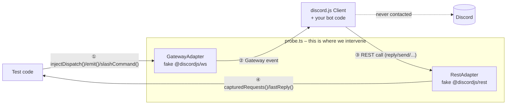

> [!WARNING]
> **Work in progress.** probe.ts is freshly built and not yet battle-tested at scale — the public API may still change before a stable `v0.1.0`. Feedback and bug reports are very welcome.

probe.ts is a lightweight testing framework for [discord.js](https://discord.js.org/) bots, built to make testing commands, components, and events fast, deterministic, and completely offline.

## Overview

Testing Discord bots today is painful: either you don't test at all (and find bugs live, in front of real users), or you hand-mock every discord.js model — fragile, and it breaks on every discord.js update.

probe.ts solves this at the transport layer instead: it fakes only the two boundaries of discord.js (`@discordjs/ws` and `@discordjs/rest`), never the model classes. discord.js builds real `Message`/`Interaction`/`GuildMember` objects from the faked data, so your bot code runs completely unmodified — no test Discord server, no network, tests run in milliseconds. Built for hobby and small-team bot developers who want reliability without a steep learning curve.

## Key Features

- Test **Slash Commands** — including options, subcommands (groups), `deferReply()`/`editReply()`
- Choose **who** triggers an interaction **where** with `withContext()` (user, member, guild, channel)
- Answer REST calls your bot reads from (e.g. `GET` lists) with `probe.respond()` — or let them fail like Discord would (404, 403, 429) with `restError()`
- Test **Context Menu Commands** on users and messages with `probe.contextMenu()`
- Test **Buttons**, **Select Menus**, and **Modals** — including discord.js's own collectors (`awaitMessageComponent()`, `awaitModalSubmit()`, ...)
- Test **Gateway Events** — member join/leave, message create/delete, reactions, audit log entries, prefix commands
- Evaluate **Components V2 containers** with `extractText()` — no manual tree-walking
- Export a **timeline** of every gateway event and REST call per test with `probe.exportTimeline()`
- **Seamless integration** with discord.js — real model objects, no hand-written mocks
- **Vitest-native** — no separate test runner or assertion library to learn
- Fixture builders with sensible defaults, everything overridable
- Open-source and actively developed

## Installation

```bash
npm install --save-dev probe.ts vitest
# or
yarn add -D probe.ts vitest
```

## Quick Start Example

### Bot Setup

```ts
// bot.ts
import { Client, GatewayIntentBits } from "discord.js";

export function createPingBot(): Client {
  const client = new Client({ intents: [GatewayIntentBits.Guilds] });

  client.on("interactionCreate", async (interaction) => {
    if (interaction.isChatInputCommand() && interaction.commandName === "ping") {
      await interaction.reply("🏓 Pong!");
    }
  });

  return client;
}
```

### Test Setup

```ts
// bot.test.ts
import { expect, it } from "vitest";
import { createProbe } from "probe.ts";
import { createPingBot } from "./bot.js";

it("/ping replies with Pong", async () => {
  const probe = createProbe(createPingBot());
  await probe.setup();

  await probe.slashCommand("ping").invoke();

  expect(probe.lastReply()).toMatchObject({ content: "🏓 Pong!" });

  await probe.teardown();
});
```

## Testing Gateway Events

```ts
probe.emit("guildMemberAdd", { user: { username: "anna" } });

await vi.waitFor(() => {
  expect(probe.capturedRequests()).toHaveLength(1);
});
```

Supports `guildMemberAdd`/`Remove`, `messageCreate`/`Delete`, `messageReactionAdd`/`Remove`, and `guildAuditLogEntryCreate`. Prefix commands (`!ping`) aren't a separate event — they're just a `messageCreate` with matching content. Full guide: [`docs/testing-event-handlers.md`](docs/testing-event-handlers.md).

## Testing Message Components

```ts
await probe.button("open-feedback-modal").click();
await probe.selectMenu("color-select").withValues(["green"]).select();
await probe.modal("feedback-modal").withFields({ "feedback-text": "more coffee please" }).submit();

expect(probe.lastModal()).toMatchObject({ customId: "feedback-modal" });
```

Works with discord.js's own collectors too. Full guide: [`docs/testing-message-components.md`](docs/testing-message-components.md).

## Testing Context Menus

```ts
await probe.contextMenu("Warn").onUser({ id: "42", username: "anna" });
await probe.contextMenu("Report").withContext({ user: { id: "7" } }).onMessage({ content: "spam" });
```

`interaction.targetUser`/`targetMember`/`targetMessage` are real discord.js objects.

## Testing Discord Errors

```ts
probe.respond("GET", /\/channels\/\d+$/, () => restError(404, { code: 10003, message: "Unknown Channel" }));
```

The bot gets a real `DiscordAPIError`. For a 429, pass a `Retry-After` header and fail only once (return `undefined` on the next call) — discord.js waits and sends the call again.

## Debugging with the Timeline

`probe.timeline()` lists everything that crossed the fake transport — injected gateway events and the bot's REST calls with probe.ts's answers — in order, each with `at` (ms since `createProbe()`). Export it after each test to see what happened when one fails:

```ts
afterEach(async (ctx) => {
  await probe.exportTimeline(`traces/${ctx.task.name}.json`);
});
```

To browse traces, open [`tools/timeline-viewer.html`](tools/timeline-viewer.html) in a browser and drop one or more files in. Besides a single `exportTimeline()` file it reads whole test files as `[{ file, test, status, duration, entries }]` (`status`: `passed`/`failed`/`skipped`; `file` defaults to the JSON's name, `duration` to the span of `entries`). It shows a run overview, tests grouped by file with status and duration, and each file's timeline. Several such files can be merged into one by concatenating their arrays.

## How It Works

probe.ts fakes exactly two boundaries — everything else is real discord.js:



### Terminology

- **Probe**: the object returned by `createProbe(client)` — your interface to inject events and read captured REST calls
- **GatewayAdapter**: fake `@discordjs/ws` — injects raw Gateway dispatch payloads
- **RestAdapter**: fake `@discordjs/rest` — captures outgoing REST calls instead of sending them
- **Fixture**: a builder that produces a raw Gateway/REST payload with sensible, overridable defaults

Architecture deep-dive: every `src/` subfolder has its own `README.md`; overall contributor context lives in `CLAUDE.md`.

## Integration with discord.js

probe.ts works with discord.js v14+. You can integrate it without modifying your existing command or event handling structure — your bot code runs completely unchanged.

## Current Status

**Implemented:** Slash Commands (incl. user options and subcommands/groups), Buttons/Select Menus (string-select)/Modals with collectors, per-interaction user/guild/channel via `withContext()`, Context Menu Commands (user and message), real `Message` responses for `channel.send()`/`followUp()`/`editReply()` plus custom REST responses and Discord errors via `probe.respond()`/`restError()`, the gateway events listed above, Components V2 container evaluation, a per-probe timeline via `probe.timeline()`/`exportTimeline()`.

**Not yet supported:** custom Vitest matchers, other select-menu types (user/role/mentionable/channel), a `Message` from `interaction.reply({ withResponse: true })`, `followUp()` in `lastReply()`/`allReplies()` (it only shows up in `capturedRequests()`), embed snapshot testing, timer control for collectors, permission/role simulation.

## Use Cases

- Testing Slash Commands, Buttons, Select Menus, and Modals without a live bot
- Regression-testing event handlers (welcome messages, reaction roles, prefix commands)
- Fast, deterministic CI checks for discord.js bots
- Catching breaking discord.js updates before they reach production

## License

MIT © 2026 GalaxyBot
