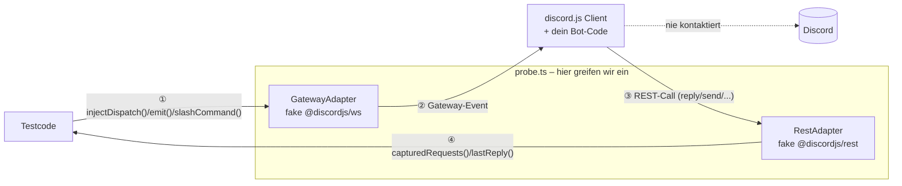

# `src/transport/`

Die zwei Grenzen, an denen probe.ts discord.js faked – der Rest von
discord.js läuft echt. Siehe `CLAUDE.md` für das Kern-Prinzip.

## `gateway-adapter.ts` – eingehend

`GatewayAdapter` implementiert `@discordjs/ws`'s `IShardingStrategy` und
wird über `client.options.ws.buildStrategy` eingehängt. Statt Sockets zu
öffnen, hält er nur eine Referenz auf den `WebSocketManager`, den
discord.js selbst baut, und emittiert Gateway-Events direkt auf diesem
Manager – genau das, was `SimpleShardingStrategy` intern auch tut.
discord.js verarbeitet die Events über seinen echten `handlePacket`/
Actions-Pfad und baut daraus echte Model-Objekte (`Message`,
`ChatInputCommandInteraction`, `GuildMember`, ...).

Zwei Methoden:

- `injectReady(data)` – fährt Shard 0 hoch (`Ready`-Event + Dispatch
  `{t: 'READY'}`). Nur beim `setup()`-Handshake gebraucht.
- `injectDispatch(payload)` – der generische Fall. Reicht für praktisch
  jedes neue Event: nur eine neue Test-Payload nötig, keine neue Methode
  (siehe `build-gateway-payload`-Skill).

## `rest-adapter.ts` – ausgehend

`RestAdapter.makeRequest` ersetzt `@discordjs/rest`'s echten
undici-Transport (`RESTOptions.makeRequest`). Zeichnet jeden ausgehenden
Call in `requests` auf und beantwortet ihn, ohne Netzwerk:

- `/gateway/bot` (fragt `client.login()` vor dem Verbindungsaufbau ab) –
  Fake-Wert, wird nicht aufgezeichnet
- Routen, auf die Discord mit einer Nachricht antwortet (`POST`/`PATCH`
  `/channels/:id/messages…`, `followUp()`/`editReply()` über
  `/webhooks/…`) – eine vollständige `APIMessage` mit frischer Snowflake und
  dem gesendeten Body; die Id merkt sich `lastMessageId` als Default-Ziel für
  `probe.button()`/`selectMenu()`
- über `probe.respond(method, pfad, responder)` hinterlegte Routen (Vorrang
  vor den eingebauten), z.B. Listen, die der Bot per `GET` lädt
- alles andere: leere 204-Antwort

## Erweiterungspunkt

Neue Interaktions-/Event-Art (Buttons, Modals, Prefix-Commands,
Reactions, ...)? Fast immer reicht eine neue rohe Test-Payload –
**kein** Adapter-Change nötig. Eine neue Adapter-Methode ist nur
gerechtfertigt, wenn das Event einen Mehrschritt-Tanz braucht wie
`injectReady`. Details + Checkliste: `.claude/skills/
transport-boundary-check/SKILL.md`.

## Die eine Regel

**Nie** eine discord.js-Model-Klasse selbst mocken. Immer nur rohe
Gateway-/REST-Payloads injizieren bzw. abfangen und discord.js echte
Objekte daraus bauen lassen. Adapter bleiben intern – `GatewayAdapter`/
`RestAdapter` selbst sind nie Teil der öffentlichen API (`src/index.ts`
exportiert Fixture-Builder, Invocation-Typen etc., aber nie die Adapter
direkt).
