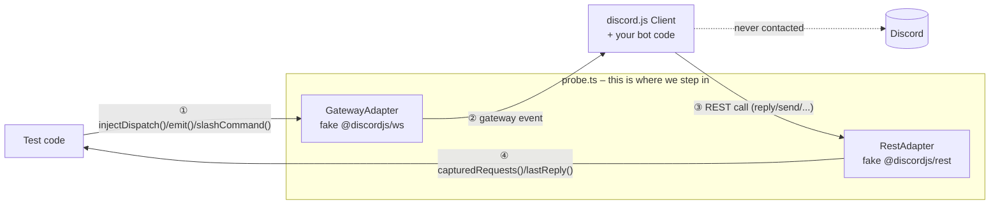

# `src/transport/`

The two boundaries where probe.ts fakes discord.js – the rest of discord.js
runs for real. See `CLAUDE.md` for the core principle.

## `gateway-adapter.ts` – incoming

`GatewayAdapter` implements `@discordjs/ws`'s `IShardingStrategy` and is
hooked in via `client.options.ws.buildStrategy`. Instead of opening sockets,
it only holds a reference to the `WebSocketManager` discord.js builds itself,
and emits gateway events directly on that manager – exactly what
`SimpleShardingStrategy` does internally too. discord.js processes the
events through its real `handlePacket`/actions path and builds real model
objects from them (`Message`, `ChatInputCommandInteraction`, `GuildMember`,
...).

Two methods:

- `injectReady(data)` – brings shard 0 up (`Ready` event + dispatch
  `{t: 'READY'}`). Only needed for the `setup()` handshake.
- `injectDispatch(payload)` – the generic case. Enough for practically every
  new event: only a new test payload needed, no new method (see
  `../fixtures/README.md`).

## `rest-adapter.ts` – outgoing

`RestAdapter.makeRequest` replaces `@discordjs/rest`'s real undici transport
(`RESTOptions.makeRequest`). Records every outgoing call in `requests` and
answers it without network:

- `/gateway/bot` (fetched by `client.login()` before connecting) – fake
  value, not recorded
- routes Discord answers with a message (`POST`/`PATCH`
  `/channels/:id/messages…`, `followUp()`/`editReply()` via `/webhooks/…`) –
  a complete `APIMessage` with a fresh snowflake and the sent body; the id is
  kept in `lastMessageId` as the default target for
  `probe.button()`/`selectMenu()`
- routes registered via `probe.respond(method, path, responder)` (take
  precedence over the built-in ones), e.g. lists the bot loads via `GET`;
  a responder returning `restError(status, body, headers?)` answers with that
  status, so discord.js throws a real `DiscordAPIError` (or waits out a 429)
- everything else: empty 204 response

## Extension point

New interaction/event kind (buttons, modals, prefix commands, reactions,
...)? Almost always a new raw test payload is enough – **no** adapter change
needed. A new adapter method is only justified if the event needs a
multi-step dance like `injectReady`.

## The one rule

**Never** mock a discord.js model class yourself. Always only inject or
capture raw gateway/REST payloads and let discord.js build real objects from
them. Adapters stay internal – `GatewayAdapter`/`RestAdapter` themselves are
never part of the public API (`src/index.ts` exports fixture builders,
invocation types etc., but never the adapters directly).
